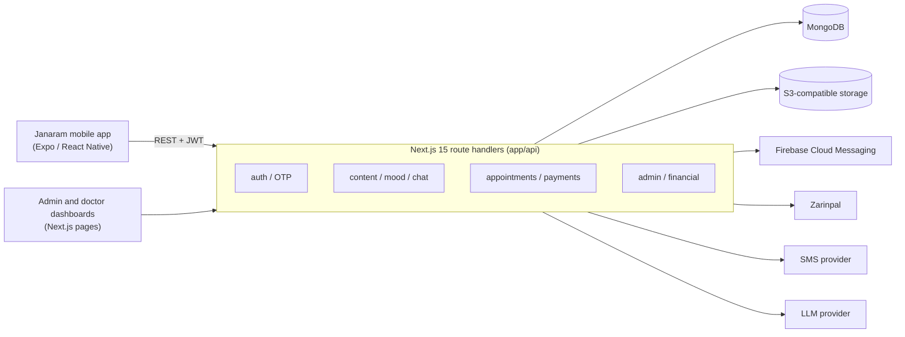

# Janaram Next

Backend, admin panel and psychologist dashboard for **Janaram**, a Persian-language mental-wellness app (mood tracking, guided meditation and breathing, an AI chat companion, and paid sessions with psychologists).

The mobile client lives in [Janaram](https://github.com/salarmiirzaeie/Janaram) (React Native / Expo). This repository is the Next.js app that serves its API and the web dashboards.

## What it does

- **REST API for the mobile app**: phone-number OTP login, profile and onboarding, mood logging, meditation and breathing content, exercises, psychological tests, blog, AI conversations with history and analysis.
- **Psychologist marketplace**: browse psychologists, check available slots, book and pay for appointments, leave reviews, refunds.
- **Payments**: Zarinpal payment request, callback, inquiry and status, with a mock gateway for development.
- **Doctor dashboard** (`/doctor`): schedule, appointments (today, upcoming, past), earnings, bank account, settlement and withdraw requests.
- **Admin panel** (`/admin`): content management (blogs, meditations, breathing exercises), psychologist management, financial reports (daily, settlements, deposit sync), refunds, withdraw approvals, push notifications, platform commission settings, analytics (user growth, daily mood, paid users, conversations).
- **Push notifications**: Firebase Admin and Expo push, with a per-user token and a broadcast topic.
- **Self-hosted Expo OTA updates**: `/api/updates/*` serves the `expo-updates` manifest, bundles and assets to the mobile app.

## Architecture



## Stack

Next.js 15 (App Router, Turbopack), React 19, TypeScript, Tailwind CSS 4, MongoDB (native driver), JWT and bcrypt, AWS SDK v3 (S3), Firebase Admin, Recharts, Tiptap, Vitest.

## Authentication model

| Role | How they sign in | Token claim | Guard |
|---|---|---|---|
| User | phone number and OTP | no `role` claim | `withAuth` |
| Doctor | email and password | `role: "doctor"` | `withDoctorAuth` |
| Admin | email and password | `role: "admin"` | `withAdminAuth` |

All three token types are signed with the same `JWT_SECRET`, so every guard must check the **role claim**, not only the signature. `tests/middleware.test.ts` covers this, including the case where an ordinary user token must not reach admin routes.

## Getting started

```bash
nvm use                     # Node version from .nvmrc
npm install
cp .env.example .env.local  # then fill in the values
npm run dev                 # http://localhost:3000
```

Required environment variables are listed in [`.env.example`](.env.example). Never commit real secrets. The Firebase service account goes into `FIREBASE_SERVICE_ACCOUNT_JSON` as a single-line JSON string.

## Scripts

| Command | What it does |
|---|---|
| `npm run dev` | development server |
| `npm run build` / `npm start` | production build and server |
| `npm test` | unit tests (Vitest) |
| `npm run typecheck` | `tsc --noEmit` |

## Tests

`npm test` runs the Vitest suite in `tests/`: JWT verification (valid, expired, wrong secret, `alg: none`), the three auth middlewares, the doctor JWT helpers, slug generation and commission math. CI runs the tests on every push and pull request.

## Project layout

```
app/
  api/          route handlers (auth, mood, meditation, v2/appointments, payment, admin, ...)
  admin/        admin dashboard pages
  doctor/       psychologist dashboard pages
  (home)/       public site: landing page, blog, psychologist pages
components/     UI components
lib/            auth and middleware, MongoDB client, payments, booking and financial logic, storage, SMS, notifications
tests/          Vitest suites
```

## Deployment

Configured for [Liara](https://liara.ir) (`liara.json`). Any Node 20+ host works, provided the environment variables from `.env.example` are set.
